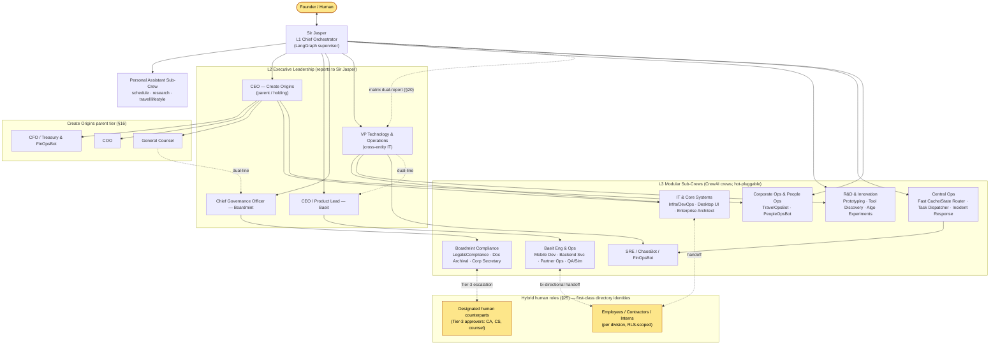
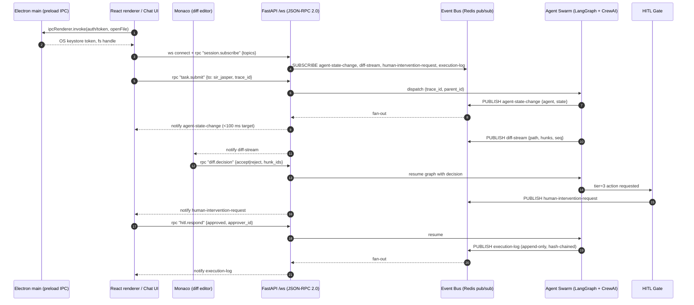
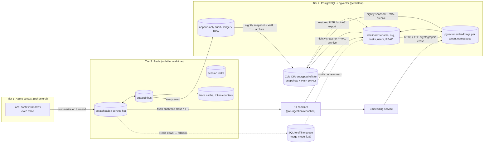
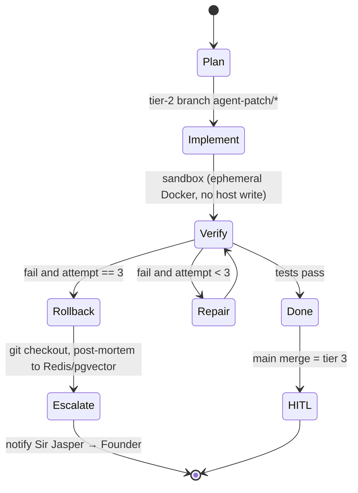
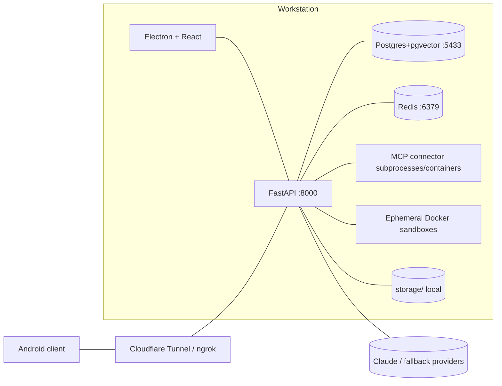

# 02 — System Architecture Blueprint (Sir Jasper AI)

All elements trace to `Sir Jasper AI.docx` (§N). Where the spec is silent, the item is tagged **[assumption]**.

## 1. Target repository layout

```
COOS/
├── backend/
│   ├── api/        FastAPI routers, /ws JSON-RPC endpoint, tunnel-safe auth        (§6, §12)
│   ├── agents/     jasper/, executives/, crews/{it,baeit,boardmint,rnd,coreops,people,personal}/,
│   │               graphs/ (LangGraph), improvement/ (PIP)                          (§2, §19)
│   ├── core/       config, vault (OS keystore), event_bus, finops, hitl, telemetry   (§11, §12)
│   ├── memory/     pg (SQLAlchemy+Alembic, pgvector), redis (cache/pubsub/locks)     (§4)
│   └── mcp/        registry, supervisor, sandbox runners, connectors/*               (§12, §14)
├── frontend/       Electron main/preload + React renderer (Monaco, office, chat)    (§7)
├── infra/          docker-compose.yml (postgres+pgvector, redis ONLY), migrations/    (§12)
├── storage/        vector indices, artifacts, scratchpads  — fully git-ignored        (§2)
└── docs/
```

## 2. Agent topology (Sir Jasper → CEOs → sub-crews → hybrid humans)



Notes: Matrix (dotted dual-reporting) per §20; subsidiaries Baeit/Boardmint have their own HR/Legal/CS/CA units (§16) instantiated as additional crews under their lead **[assumption: modelled as optional crews, not first-class L2 nodes]**. R&D reports to Sir Jasper *or* Head of Tech (§2). Dev-loop bots (Mobile/Backend/QA) run the LangGraph cycle in §5.

## 3. Bidirectional IPC / WebSocket event loop



Principles: one `/ws` per client; JSON-RPC 2.0 requests (client→server), notifications (server→client), correlation by `trace_id` + `parent_id` (§17). Sub-100 ms budget (§12) applies to publish→render for the four topics; measured via OTel span `event.deliver`. LSP bridging for Monaco is a second channel `/lsp` **[assumption: spec says "WebSocket/LSP"]**. Mobile (Android) uses the same `/ws` via Cloudflare Tunnel/ngrok with token auth (§6).

## 4. Unified memory lifecycle



Rules: nothing reaches `VEC`/`REL` without the sanitizer (§15, §25). Each tenant (Create Origins, Baeit, Boardmint) has its own schema + RLS; vector rows carry `tenant_id` and are filtered by RLS (§11). Audit table is insert-only with hash chain (§17). Redis keys namespaced `tenant:{id}:…` with TTLs; token counters feed FinOps (§23).

## 5. Bounded self-healing dev loop (LangGraph) — §3 Flow 1, §10



## 6. Cross-cutting services

| Concern | Design | Spec |
|---|---|---|
| Inference | Provider abstraction; Claude primary; tiered routing (cheap model for classify/route, frontier for orchestration/AST repair); prompt caching; circuit breaker on budget/quota; fallback chain; Ollama/llama.cpp only as Tier-1 offline fallback | §5, §11, §23 |
| FinOps | Per call: `tenant, agent, crew, model, in/out tokens, cost`; Redis counters (hot) → PG ledger; soft/hard caps per request/day per division; `breaker.open` event halts loops | §11, §23 |
| HITL | Central policy table `action → tier`; Tier 1 auto, Tier 2 notify, Tier 3 block until `hitl.respond` | §11, §13, §14 |
| Vault | Windows Credential Manager/DPAPI via `keyring`; no secrets in `.env` except bootstrap; OAuth loopback with refresh rotation | §11, §14 |
| MCP hub | Registry in PG; supervisor spawns connector subprocess/container; capability handshake → tools registered into agent registry → `tool-registry-changed` event; per-connector scopes + rate budgets + audit | §12, §14 |
| Observability | OpenTelemetry spans across LangGraph nodes & CrewAI tasks; Langfuse/LangSmith exporter optional; Prometheus metrics; Grafana optional | §12, §22, §23 |
| SRE | SLIs: Tier-1 latency <2000 ms, multi-hop <15 s, tool success >99.5 %; error-budget burn → freeze non-critical autonomous commits; runbooks as versioned YAML executed by IncidentResponseBot | §22 |
| Chaos | ChaosBot injects faults only in staging/sandbox; asserts recursion cap and rollback hooks | §21 |
| Compliance | SBOM + license gate pre-merge (GPL/AGPL block), commit provenance signatures, snippet-similarity check, retention TTL + RTBF + crypto-erase | §15 |
| Spinoff | Per-tenant export: pg_dump of tenant schema + pgvector rows + git history + logs → bundle | §12, §16 |
| Onboarding | Role spec → synthetic interview → benchmark → clearance → registry + memory namespace + office avatar; start Tier 1/2 only; PIP loop on SLA breach | §18, §19 |

## 7. Service topology (host)


Docker Compose runs **only** Postgres+pgvector and Redis (§12). FastAPI, Electron and workers run as host processes under a supervisor with health checks and graceful shutdown (§12).

## 8. Open questions (spec ambiguity)
1. §2 lists "Hermes Agent" as both a module and a PIP engine — treated as a library/pattern, not a service.
2. §16 subsidiary HR/Legal/CS/CA units vs §2 sub-crews overlap (e.g., Corporate Secretary Bot). Proposed: *bot = role instance inside a tenant crew*.
3. §7 says "Phaser"; the repo uses Pixi. Spec governs unless you decide otherwise (Pixi is already integrated).
4. §5 says no local LLM weights, §23 wants Ollama fallback — reconciled as "edge-only, off by default".
